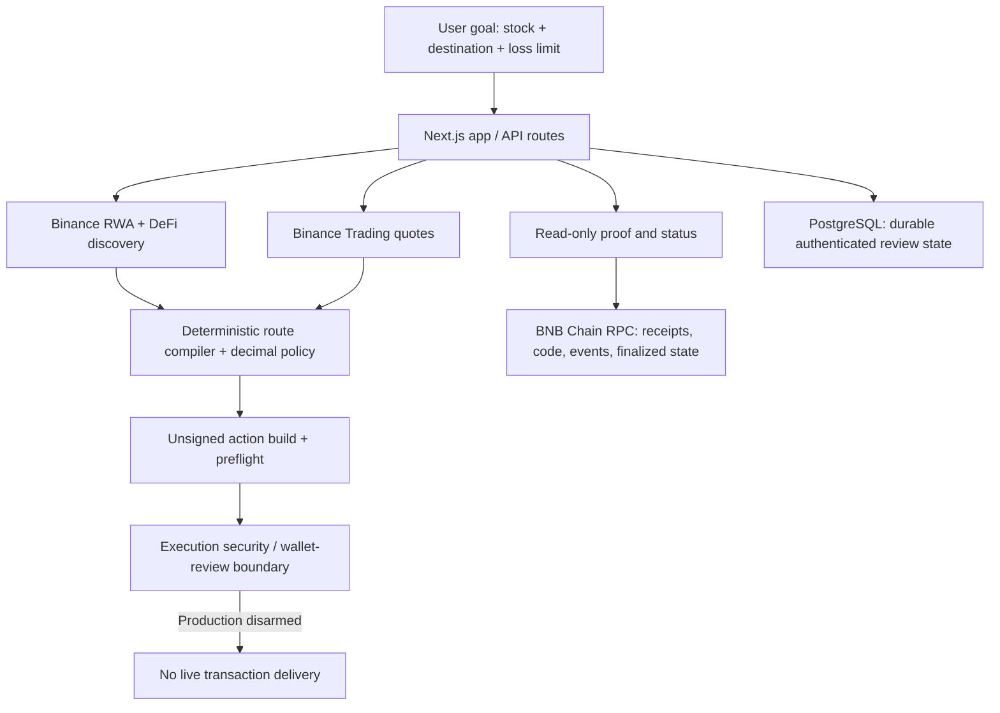

<div align="center">

# EquityRelay

### Own the stock. We handle the rail.

**A destination-first router for tokenized stocks on BNB Chain.**

Move from *the stock representation you hold* toward *the DeFi destination you want*—with issuer-aware routing, normalized exposure limits, transaction preflight and evidence you can inspect.

**Built for BNB Hack · Tokenized Stocks Edition · 2026**

[**Open EquityRelay**](https://equityrelay.vercel.app) · [**Try a live preview**](https://equityrelay.vercel.app/app) · [**Explore the demo**](https://equityrelay.vercel.app/demo) · [**See the security decision**](https://equityrelay.vercel.app/proof/execution-safety)

</div>

---

## The problem: same stock, different rails

A tokenized stock can have multiple issuer-specific representations on BNB Chain. These representations are **not automatically interchangeable**, and DeFi protocols may support only one of them.

**Example:** You hold NVIDIA exposure as Ondo's **NVDAon**, but the selected Venus market accepts the bStocks representation **NVDAB**. A direct conversion cannot be assumed to work, and raw token balances cannot be compared as if they represented identical numbers of underlying shares.

EquityRelay starts from your **destination**, not from a long list of token contracts.

```text
Your intent: "I hold NVIDIA exposure. I want to use it on Venus."

  NVDAon (Ondo representation)
      │
      ▼
  USDT   (issuer-compliant settlement)
      │
      ▼
  NVDAB  (bStocks representation)
      │
      ▼
  Venus  (compatible destination)
```

The route must satisfy a user-defined **maximum reduction in normalized underlying-stock exposure**. A quoted route passing that financial check does **not** imply its transaction authorization is safe.

## Explore the working product

| Experience | What you can inspect |
| --- | --- |
| [**Live route builder**](https://equityrelay.vercel.app/app) | Current Binance API-backed route availability, issuer compatibility, normalized exposure and read-only preflight |
| [**Why this route?**](https://equityrelay.vercel.app/why-this-route) | The issuer constraint, USDT settlement path, exposure policy and separate authorization decision |
| [**Execution safety proof**](https://equityrelay.vercel.app/proof/execution-safety) | The cancelled wallet approval review, router-provenance investigation and a live, read-only **Recheck router** control |
| [**Venus verifier proof**](https://equityrelay.vercel.app/proof/venus-verifier) | Canonical historical BSC supply evidence, events, token transfers and position reconciliation |
| [**Feasibility evidence**](https://equityrelay.vercel.app/proof/feasibility) | Dated real API observations behind the two-leg route |
| [**System status**](https://equityrelay.vercel.app/status) | On-demand infrastructure checks with explicit available, unavailable, stale and not-checked states |
| [**Demo journey**](https://equityrelay.vercel.app/demo) | A guided path through the product, route explanation and evidence pages |

**Judge walkthrough (about 90 seconds):** Open the [app](https://equityrelay.vercel.app/app) → preview an NVIDIA-to-Venus route → read [why the route exists](https://equityrelay.vercel.app/why-this-route) → inspect the [execution security decision](https://equityrelay.vercel.app/proof/execution-safety) → click **Recheck router on BNB Chain** → open the [historical Venus verifier](https://equityrelay.vercel.app/proof/venus-verifier).

> **Current submission status:** Real BSC mainnet data and historical canonical BSC evidence are used. **No EquityRelay swap or Venus deposit was signed or broadcast.** Production execution remains intentionally **disarmed**. Read-only functionality is live; live route availability depends on current Binance liquidity and API responses.

## How EquityRelay works

| Layer | Product behavior | Evidence / boundary |
| --- | --- | --- |
| **Discover** | Identifies supported Ondo/bStock representations and the Venus destination | Binance RWA Data and DeFi Data; availability is checked live |
| **Compile** | Constructs an issuer-valid route through USDT when a direct cross-issuer pair is not supported | Direct NVDAon → NVDAB returned Binance business code **40368** in the dated feasibility study |
| **Normalize** | Converts wrapper units into underlying-share-equivalent exposure using the relevant ratios | Decimal-safe policy; projected exposure is **not** realized exposure |
| **Preflight** | Builds unsigned actions and checks amounts, approvals, transaction semantics and available simulations | Exact bounded approvals; later legs remain indicative until earlier settlement |
| **Authorize** | Keeps wallet authority with the user and checks execution readiness | Mainnet transaction delivery is disabled in production; observed router authorization was not completed |
| **Verify** | Has canonical receipt/transfer/event and historical position-verification machinery | The published Venus examples are **historical third-party protocol activity**, not EquityRelay transactions |

**Preview coverage:** NVIDIA (NVDA), SpaceX (SPCX) and Tesla (TSLA), each subject to live issuer, liquidity and destination availability. Current route support and historical verifier coverage must not be confused with successful end-to-end EquityRelay execution.

### A policy check you can reason about

```text
Normalized source shares = source token amount × source token-to-share ratio
Normalized target shares = projected target amount × target token-to-share ratio

Projected retention = normalized target shares / normalized source shares

PASS only if projected retention meets the user's minimum.
```

The default illustrated maximum exposure reduction is **0.50%** (minimum 99.50% retention). The calculation uses ratio snapshots and decimal-safe arithmetic—not a comparison of token balances or an AI-generated recommendation.

## The mainnet authorization decision

During supervised review, EquityRelay opened an **exact USDT approval review** in Binance Wallet. The wallet labeled the proposed spender **high-risk / unverified**, and the user **cancelled the review**.

A subsequent **read-only provenance investigation** established that:

- Three authenticated Binance Web3 builds identified **LiquidMesh** and returned the same BSC approval spender and swap target, [`0xB44446b0c8E56988c34f7Ff73Ae904982b5FdDA5`](https://bscscan.com/address/0xB44446b0c8E56988c34f7Ff73Ae904982b5FdDA5).
- The deployed target was an **ERC-2535 diamond** with active facets. Its BSC source and the detected facet sources were **unverified**.
- No published Binance/LiquidMesh chain-specific contract registry or matching deployment-specific audit was established.

**Evidence classification:** `API_PROVENANCE_ONLY`  
**Recorded operator/security decision:** `SECURITY_REFUSED_UNVERIFIED_ROUTER`

**What did *not* happen:** No approval transaction was signed or broadcast, no allowance was confirmed on-chain, and no EquityRelay route was executed.

**Important distinction:** This provenance refusal is a **recorded operator decision**, **not** an automatically enforced contract-provenance gate in the current action-delivery code. Production remains disarmed using `EQUITYRELAY_MAINNET_EXECUTION=false`; the deprecated execution relay remains locked.

[**Read the complete security record and recheck the router**](https://equityrelay.vercel.app/proof/execution-safety) · [Security model](SECURITY.md) · [Judge Q&A](docs/JUDGE_QA.md)

### Independent evidence, without a wallet

The security page's **Recheck router on BNB Chain** control performs a read-only chain check and compares the observed runtime code's Keccak-256 hash against the recorded reference. A **MATCH** establishes **bytecode consistency only**—**not** source verification, ownership, or contract safety. The page also reports explicit mismatch/unavailable states.

Separately, the [Venus proof](https://equityrelay.vercel.app/proof/venus-verifier) checks a real **historical** NVDAB supply at BSC block `124836339`. It ties the canonical transaction and receipt to `mint(uint256)`, Venus events, NVDAB/vNVDAB token movements and block-specific position evidence. **This was not an EquityRelay-executed transaction.**

## Architecture



The financial decision engine is deterministic; no model can override the exposure policy. Server-side Binance credentials are not exposed to the browser. Wallet authentication and the guarded action-delivery design are separate from actual transaction signing. **EquityRelay has not deployed a custom Solidity contract**; it integrates existing BSC token, swap and Venus contracts.

| Area | Implementation |
| --- | --- |
| Frontend / APIs | Next.js App Router, React, TypeScript |
| Financial arithmetic and validation | `decimal.js`, Zod, deterministic domain rules |
| BSC integration | Viem, BSC RPC, Binance Web3 APIs |
| Durable state | PostgreSQL / Neon, migration scripts |
| Deployment | Vercel, server-side API integration |
| Testing | Vitest, TypeScript, ESLint, migration checks |

Repository structure: `src/domain/` (policy, identities, execution decisions), `src/lib/binance/` (signed API adapters), `src/lib/execution/` (readiness/reconciliation), `src/app/` (routes and proof pages), `src/components/` (UI), `docs/` (specifications, demo and evidence).

## Run locally

**Requirements:** Node.js **20.9+**, npm and PostgreSQL **16+**.

```bash
git clone https://github.com/Alike001/equityrelay.git
cd equityrelay
npm ci
cp .env.example .env.local
```

Configure server-side values in `.env.local`:

| Variable | Purpose |
| --- | --- |
| `BINANCE_W3_API_KEY` / `BINANCE_W3_API_SECRET` | Authenticated Binance Web3 requests |
| `DATABASE_URL` | PostgreSQL connection for persistent routes and auth |
| `EQUITYRELAY_BSC_RPC_URL` | BSC RPC with supported canonical/historical reads |
| `EQUITYRELAY_PUBLIC_ORIGIN` | Exact app origin, e.g. `http://localhost:3000` |
| `EQUITYRELAY_MAINNET_EXECUTION=false` | **Keep transaction delivery disarmed** |
| `EQUITYRELAY_TRUSTED_CLIENT_IP_HEADER` / `EQUITYRELAY_RATE_LIMIT_SECRET` | Required trusted-proxy/rate-limit configuration for auth endpoints |

For production, the proxy must overwrite the selected trusted IP header; do not trust arbitrary user-supplied headers. `EQUITYRELAY_RATE_LIMIT_SECRET` must be a stable server-side secret (at least 32 characters). See [SECURITY.md](SECURITY.md) for threat boundaries and required RPC capabilities.

```bash
npm run migrate
npm run dev
# visit http://localhost:3000
```

Without configured Binance credentials or a qualified RPC, affected actions must report **UNAVAILABLE**, not fabricate a quote or proof. Do not use a production database for integration tests.

### Validation

```bash
npm run typecheck
npm run lint
npm test
npm run migrate:validate
npm run build
```

Phase 4 verification reported **335 passing tests, 2 skipped**, a passing production build and typecheck/lint checks, and **zero production dependency audit vulnerabilities**. These are dated validation results, not live CI badges.

## What is proven—and what remains

| Proven / implemented | Not claimed |
| --- | --- |
| Authenticated read-only BNB route discovery and issuer-constraint handling | A completed EquityRelay mainnet conversion |
| Normalized exposure policy and exact unsigned approval preparation | That quote-time estimates guarantee realized results |
| Canonical **historical** Venus supply/redeem verifier coverage | That historical Venus activity was initiated by EquityRelay |
| Durable, authenticated review and settlement-verification architecture | That the reviewed LiquidMesh contract is verified, audited or Binance-owned |
| Operator refusal and documented security investigation | An automatically enforced deployed-contract provenance gate |
| Public read-only code recheck and status views | An independently safe or authorized router based solely on bytecode matching |

**Scope:** Spot tokenized-stock representation routing on BSC. EquityRelay is not a lending protocol, autonomous trading bot, generic stock screener or investment recommendation engine. Tokenized-stock products may carry issuer, custody, liquidity and jurisdictional restrictions and do not necessarily convey direct company share ownership or shareholder rights.

## Development evidence and documentation

- [**Developer Experience Report — real API observations and concrete redesign suggestions**](DEVEX_LOG.md)
- [Feasibility study: why the USDT route exists](docs/context/FEASIBILITY_RESULT_2026-09-29.md)
- [Submission walkthrough](docs/SUBMISSION_DEMO.md) and [judge Q&A](docs/JUDGE_QA.md)
- [Security review and execution boundaries](SECURITY.md)
- [Product/build specification](docs/context/BUILD_SPEC.md)
- [Phase 4 reference notes and attribution](docs/PHASE4_REFERENCE_NOTES.md)

The DevEx log covers concrete Binance and BSC integration findings, including issuer pairing error **40368**, the observed minimum-order error **40375**, broad approval calldata, multi-step simulation limitations, RPC historical-log restrictions and the unverified router provenance gap. It distinguishes expected behavior, actual observations, workarounds and proposed improvements.

---

<div align="center">

**Your stock. Your destination. Your limit.**

[Open the app](https://equityrelay.vercel.app/app) · [See the proof](https://equityrelay.vercel.app/proof/execution-safety) · [GitHub](https://github.com/Alike001/equityrelay)

*Built for BNB Hack · Tokenized Stocks Edition, 2026.*

</div>
